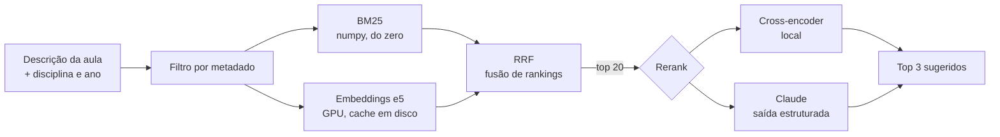

# bncc-retrieval

**Dada a descrição de uma aula, quais habilidades da BNCC ela trabalha?**

Professores precisam declarar, em todo planejamento, os códigos da BNCC de cada aula. São 1301 habilidades só no Ensino Fundamental, e muitas se parecem. Este projeto compara, num benchmark reproduzível, cinco jeitos de sugerir os códigos: busca léxica, embeddings, busca híbrida, cross-encoder e rerank com LLM (Claude). O fluxo de produto é "o sistema sugere três, o professor confirma uma".

```
$ bncc-sugerir "Em bancadas, os alunos misturam água com sal, água com óleo e água com areia \
  em copos transparentes e anotam se dá para ver as partes separadas." --componente CI --ano 6
1. EF06CI01  Classificar como homogênea ou heterogênea a mistura de dois ou mais materiais ...
```

## Resultados

Conjunto de teste: 200 aulas, nunca usadas para ajustar nada. IC 95% por bootstrap. Detalhes em [`results/RESULTADOS_test.md`](results/RESULTADOS_test.md).

**Cenário filtrado** (o professor informou disciplina e ano; concorrem de 10 a 60 habilidades):

| Método | MRR (IC 95%) | Hit@1 | Hit@3 | Hit@5 | ms/consulta |
|---|---|---|---|---|---|
| Jaccard | 0,642 (0,589–0,695) | 50,5% | 71,5% | 80,5% | 3 |
| TF-IDF + cosseno | 0,660 (0,609–0,713) | 52,0% | 76,5% | 83,0% | 3 |
| BM25 | 0,654 (0,603–0,706) | 50,5% | 76,5% | 84,5% | <1 |
| Embeddings (multilingual-e5-base) | 0,729 (0,680–0,778) | 61,0% | 82,5% | 90,0% | 17 |
| Híbrido (BM25 + e5, RRF) | 0,724 (0,677–0,771) | 58,5% | 84,0% | 89,5% | 18 |
| **Híbrido + cross-encoder** (bge-reranker-v2-m3) | **0,757** (0,711–0,802) | **63,0%** | **86,0%** | **94,5%** | 187 |

**Cenário aberto** (nada informado; concorrem as 1301): o melhor é o híbrido, com MRR 0,503 e Hit@3 de 56,5%.

### O que os números dizem
1. **Saber disciplina e ano vale mais do que qualquer modelo.** O mesmo método vai de Hit@3 de 56% (aberto) para 86% (filtrado). Em produto, pedir esses dois campos ao professor é a melhoria mais barata que existe.
2. **Embeddings superam o léxico com folga** (MRR 0,73 contra 0,65; bootstrap pareado p < 0,001), porque as aulas quase não repetem as palavras da habilidade (sobreposição mediana de 7%).
3. **O cross-encoder rende onde importa:** Hit@5 de 94,5%. Custa 10× mais latência, mas continua abaixo de 0,2 s numa GPU de notebook.
4. **Língua Portuguesa é o gargalo** (Hit@3 de 71%): as 389 habilidades de LP se sobrepõem (EF15LP, EF35LP, EF69LP...), e parte dos "erros" são habilidades vizinhas igualmente válidas. Ver as limitações abaixo.

### Rerank com LLM
*Em execução: os números entram aqui com custo por mil consultas.*

## Como funciona



Decisões que valem destacar:
- **O LLM só reordena, nunca escolhe do zero.** A busca barata seleciona os 20 candidatos; o modelo ordena. O JSON Schema de cada chamada usa um `enum` com os 20 códigos daquela consulta, então o modelo não consegue inventar um código. A resposta ainda é revalidada no código, e uma recusa cai de volta na ordem da primeira etapa.
- **Custo e reprodutibilidade:** cada resposta do LLM fica em cache por hash do pedido (`results/cache_llm.jsonl`, versionado). Quem clona o repositório reproduz os números sem chave e sem gastar nada. Tokens e custo vêm do `usage` da API.
- **Léxico escrito do zero** (`lexical.py`): TF-IDF sublinear e BM25 em numpy, com stemming por truncamento para português. É a linha de base honesta contra a qual os modelos têm que provar valor.
- **Medição antes de opinião:** split dev/test fixo, intervalos de confiança e teste pareado. Diferenças dentro do IC não são vendidas como ganho.

## Benchmark
Não existe conjunto público de aulas rotuladas com a BNCC, então criei um: 300 habilidades sorteadas e estratificadas, uma aula escrita para cada uma sem parafrasear a habilidade, checagem automática de vazamento de texto e revisão humana por amostragem. Protocolo e limitações em [`docs/benchmark.md`](docs/benchmark.md).

**Limitações:** as aulas são sintéticas (os números são otimistas para aulas reais), há um único rótulo por aula (o que pune habilidades vizinhas válidas) e as aulas foram escritas por um modelo da mesma família do rerank.

## Rodando

```bash
python -m venv .venv && source .venv/bin/activate
pip install -e ".[dense,llm,dev]"

pytest                                   # 20 testes; o LLM é testado com cliente falso, sem rede
bncc-avaliar --split test                # métodos locais (baixa os modelos na 1ª vez)
bncc-avaliar --split test --llm          # + Claude; usa o cache, só chama a API no que faltar
bncc-sugerir "descrição da aula" --componente MA --ano 6
```

Para chamar a API: `cp .env.example .env` e coloque a sua chave (o `.env` está no `.gitignore`).
Para regerar o corpus: baixe o [PDF oficial da BNCC](http://basenacionalcomum.mec.gov.br/images/BNCC_20dez_site.pdf) e rode `python -m bncc_retrieval.extract BNCC_20dez_site.pdf` (precisa do `pdftotext`, do poppler).

## Estrutura

```
src/bncc_retrieval/
  extract.py      PDF oficial -> data/bncc_ef.csv
  bncc.py         códigos, anos, componentes, filtro por metadado
  text.py         normalização e tokenização para português
  lexical.py      Jaccard, TF-IDF, BM25 (numpy)
  dense.py        embeddings e cross-encoder (sentence-transformers)
  fusion.py       Reciprocal Rank Fusion
  llm_rerank.py   rerank com Claude: schema com enum, cache, custo, fallback
  metrics.py      MRR, Hit@k, nDCG, bootstrap
  evaluate.py     benchmark -> results/
  cli.py          bncc-sugerir
data/             corpus extraído e consultas do benchmark
docs/             protocolo, prompt de geração, revisão humana
results/          métricas e cache das respostas do LLM
```

## Próximos passos
- Rótulos múltiplos por aula (habilidades vizinhas válidas) e métricas que aceitem isso.
- Fine-tuning do bi-encoder com pares sintéticos (dev) para ver quanto do cross-encoder dá para levar à primeira etapa.
- Avaliar com aulas reais e anonimizadas, escritas por professores.

Licença MIT. A BNCC é um documento público do Ministério da Educação.
